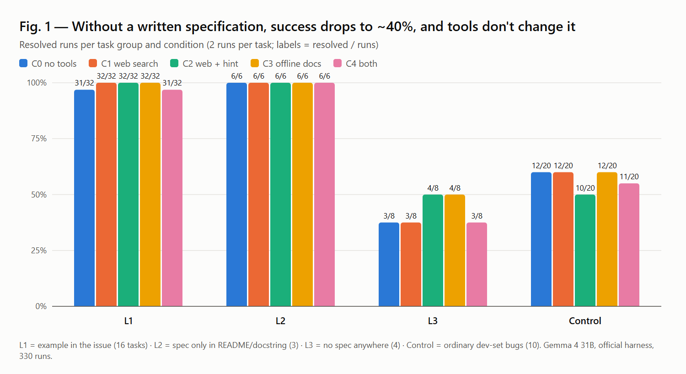
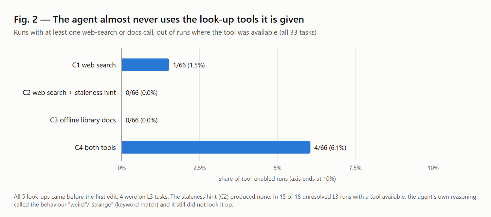

# Fixing Is Easy, Knowing Isn't

### Does a Gemma 4 coding agent notice when its library knowledge is stale, and do web search or offline docs help? A pre-registered study

*As submitted to the Kaggle Gemma 4 Developer Agent Paper Track, 10 Nov 2026: https://www.kaggle.com/competitions/gemma-4-developer-agent-paper/writeups/fixing-is-easy-knowing-isnt*

Chintan Parmar

## Abstract

After training cut off, the contents of libraries change. While fixing is easy (i.e., code can be adapted using signals that the library has changed), knowing is harder (i.e., no signals so the agent can't realise it might have out-of-date beliefs). We evaluated whether The Gemma 4 31B IT (4-bit) model (trained cut off Jan 2025) knew it knew less using the official competition harness. We evaluated 33 tasks:

12 bugs caused by library changes after cut off,

4 silent changes (no errors but different output). Each had 3 levels of specification,

10 normal bug fixing tasks as controls.

Each task had 5 conditions (pre-registered), 330 runs in total. Where there was any specification for the expected behaviour, the agent was able to fix the bugs, with no tools (31/32 and 6/6). However, with no specification, the agent struggled (3/8). 2 out of 4 tasks had no runs passing. The tools didn't help (3-4/8) since the agent almost always didn't use them (5 lookups in 264 runs with tools) even when warned it may have out of date knowledge. Most of the time, the agent mentioned the library was strange however didn't lookup the change, just making up a reason. Whilst a few lookups didn't work due to the text in the harness saying "offline", when we removed this (exploratory, not pre-registered), the hardest tasks still had no lookups. The tools still cost 25-30% more tokens in the prompts. Overall, the issue was identifying the need to find up to date information.

## 1. Introduction

A coding agent will write code based on the library versions that it has seen during training. However, during upgrades, the libraries change. Between Jan 2025 and our experiments pandas3, scikit-learn 1.8, click 8.2, marshmallow 4, Django 6, polars and Starlette all changed. Normally we would give the agent access to tools to help it find the answers [5][6]. However, this assumes the agent will realise it needs to use a tool. To investigate this we looked at:

RQ1: Does the lack of knowledge prevent the agent from solving the task based on how much specification there is?

RQ2: Will the agent use the optional tools? Will it be affected by the hint?

RQ3: Will the tools help when there isn't any knowledge?

RQ4: Will the tools cause overhead or harm when they aren't needed?

Contributions.

Task design to differentiate between knowing and fixing. 1 silent change with an example (L1), a specification using only the repository (L2), or no specification (L3).

A pre-registered evaluation of the 5 conditions using the official harness. We ran the experiments on a provably equivalent replica of the Kaggle environment. The plan was uploaded (SHA256 Manifest) [8].

Evidence of lookups and what the agent will do when it is surprised. Practical advice for teams deploying/reviewing coding agents.

## 2. Related Work

Version aware Code Generation. Many code LLMs fail to generate version correct code [2][3]. CodeUpdateArena [1] shows adding a prefix to the update documentation doesn't help models use the synthetic API updates. These benchmarks only test single-turn generation, whereas we are looking at a multi-turn agent that can run code and read the installed library.

Agent and tools. The competition harness uses the format from SWE-bench [4]. Many models can reason and Use Tools [5][6]. Self knowledge guided retrieval [7] suggests tool use should be dependent on whether the model knows the answer. However, LLMs only partially know the limits of their knowledge [9]. For example, whilst the tools work, the agent rarely uses them.

## 3. Methodology

### 3.1 Model & Harness

Model: Gemma 4 31B IT (QAT w4a16) (Kaggle Version 2). The harness uses vLLM 0.19.1 with the official server settings and sampling (Temperature 0.2, Top-p 0.95, Thinking Budget 4096, No Seed).

Agent: The official sample agent was used (swegemma 0.2.11). The standard tools were used (Read, Edit & Write File, Run Command, Status, Submit Patch).

All conditions had no LoRA adapters (Base Model) and no code graph tools.

Time Limit: 900s, 60 tool calls, 15 minute session.

### 3.2 Tasks

Changes after cut-off (12 Tasks).

We queried the model about 28 library changes after Jan 2025. We checked the changelog and annotated manually. The automatic annotator was incorrect in 9/40.

These 12 changes where incorrectly answered became tasks. These were from 8 libraries (marshmallow, polars, click, scikit-learn, Django, networkx, pandas and Starlette). The task had a small repository with the correct code for the old version and incorrect code for the new version, along with an issue describing the symptoms.

They also had hidden tests which pass on the old library, fail on the new library and pass with the reference fix. 12/12 passed with offline and the official grader.

Hinted (pre-registered): 7 of the 12 issues had either the issue name or error message containing the API element.

Silent changes (4 Changes). These had no errors or warnings with the old code, however the output changed:

pandas 3 groupby(observed=False) with unobserved categories.

scikit-learn 1.8 weighted median_absolute_error.

click 8.2+ boolean flags with environment variables.

pandas 3 Float64 missing values (NaN → NA).

Each had 3 variations:

Informative (L1) - issue had example values.

Vague (L2) - issue had no values, however the expected behaviour was defined in the README and Docstrings.

No Spec (L3) - text defining the behaviour was removed so only the old library "knew".

However, scikit-learn had no difference between the vague and no spec versions so was removed from L2. All versions were validated with exact pins. All task text was synthetically created.

Control Tasks (10 Tasks). Fixed seed of 2026 was used to sample from the public development set (FastAPI and Rich). These had an official fix that passed and empty patch that failed.

Analysis: L1 (12 changes after cut-off + 4 silent informative), L2 (3 silent vague), L3 (4 silent no spec), Control (10).

### 3.3 Conditions

| ID | Extra Tools | Prompt Additions |
|---|---|---|
| C0 | No Tools | None |
| C1 | Web search (Tavily) - Query length 200 characters max, 8 results max. Local Relay. | "A web-search skill is available… Using it is optional." |
| C2 | Same as C1. | As C1. "libraries … may be newer than your training data" |
| C3 | Offline Library Docs (Installed library, API List, Signatures, Docstrings & Source) | "A library-docs skill is available… Using it is optional." |
| C4 | Both | Both additions. |

The tools are skills available in the harness. The agent sees a 1 line description and chooses if it wants to use them. The API Key is stored in the relay outside the sandbox. All queries are logged. The additions were added to the system prompt. The official task message is the same in all conditions, saying it is "offline" and not to search outside the repository. This was kept so we could evaluate the harness as it was.

### 3.4 Platform & Equivalency

The Kaggle GPU notebooks run with no internet access, therefore the web search can't be used. All conditions were run on the same platform. This was a replica of the Kaggle GPU notebook running on Modal. It was made using the public Kaggle image plus the install steps from the notebook.

Equivalency: Same pip freeze (969 Packages), Grading (84/84 gold patch checks), Repository (30/30) and Model Files (8/8 sha256). The Hugging Face model has a newer chat template, causing the tool calls to display differently. The Kaggle model was used.

Transfer Check (Pilot): The no-tools agent (22 tasks x 2 runs per platform) had the same per-task outcome on Kaggle and Modal for 21/22 tasks. The exception also flipped between runs on 1 platform. Hardware: 1 L40S (Kaggle 4x L4).

### 3.5 Pre-registration & Stats

Tasks, Groups, Conditions, R (2 repeats) and Analysis were fixed prior to any runs. The manifest (SHA256) had 85 files (Overall Hash: 993e0afe...c35231).

The unit of analysis was the task (proportion of runs solved). The stats were calculated using 95% Bootstrapped Confidence Intervals (10,000 resamples at task level, Seed: 2026) and Exact Sign Flipping Permutation Tests. L3 had 4 tasks, so effect sizes and confidence intervals were reported.

Only infrastructure failures could be excluded, however there were none. Any runs that reached the 15 minute time limit (27) or model context window (10) were failures.

## 4. Results

### 4.1 Pilot - Our Assumption Was Incorrect

Firstly, we assumed "the model does not know the change" meant the agent would fail. However, in the no tools pilot the agent solved 24/24 runs on post-cut-off tasks and 8/8 on silent changes with an example. 7/8 with no example just the repository. 4/8 with no specification. This was because despite the model getting all the post cut-off changes wrong in the probe, the error messages, failing tests and installed source could be used to find the new API. We updated the study to include a gradient in specification. A valid task isn't necessarily a difficult task.

### 4.2 RQ1 - Knowing vs Fixing

Table 1. Runs Solved / Total Runs.

| Group | C0 No Tools | C1 Web | C2 Web + Hint | C3 Docs | C4 Both |
|---|---|---|---|---|---|
| L1 Example in Issue (16) | 31/32 | 32/32 | 32/32 | 32/32 | 31/32 |
| L2 Specification in Repo (3) | 6/6 | 6/6 | 6/6 | 6/6 | 6/6 |
| L3 No Specification (4) | 3/8 | 3/8 | 4/8 | 4/8 | 3/8 |
| Control (10) | 12/20 | 12/20 | 10/20 | 12/20 | 11/20 |

With specification (L1, L2), 188/190 runs were solved. The lack of knowledge didn't really matter. The pre-registered split (hinted vs no hint) showed no difference (70/70 vs 49/50); the 1 failed run was due to context overflow.

Without specification (L3), 17/40 runs were solved. However, there was a lot of variation.

| L3 Task | Resolved (all conditions) |
|---|---|
| pandas groupby | 9/10 |
| scikit-learn weighted metric | 8/10 |
| click environment flag | 0/10 |
| pandas Float64 missing values | 0/10 |

### 4.3 Why The Agent Struggled Without Specification

Out of the 23 runs that weren't solved, 21 had a "fix" submitted. 2 ran out of context. All 20 click and Float64 runs had a fix submitted. Looking at 6 of the traces fully, the pattern was the same every time.

The agent noticed that the library was acting strangely.

"This is extremely weird."

"Wow! … This is definitely a bug in click or a change in behavior."

"Pandas 3.1.1? That's a very new version (or a future version)."

It then made up a plausible but wrong reason for the change. For example, it decided that to_numpy() now honoured the na_value. This is wrong. It was a change in how the missing values were represented.

It then patched the code to fit its theory. It checked with its own script and submitted confidently.

This fits the "other: confabulated change" category in our pre-registered failure categories. None of the 20 runs used the tools. Several used shell commands to view the installed library. However, this only shows current behaviour.

22/23 runs had keywords like "weird", "strange" and "very new". 15/18 had no lookups despite having a tool. The agent had a signal it may have out of date knowledge.

### 4.4 RQ2 - Will The Agent Use The Tools?

In total, the agent used the tools at least once in 5/264 runs (1.9%) (See Fig. 2).

No tools were used in L1 or L2. No runs in C2 or C3 used the tools.

All 5 runs used the tools before the first edit. 4 used the tools on L3 tasks.

The queries were specific e.g., "scikit-learn median_absolute_error sample_weight change".

No effect from the hint. The hint (C2) explicitly told the agent that the libraries may be newer than the training data. However, no lookups were done (C1 no hint: 1).

Some searches were prevented due to the text in the task saying "offline". 8/198 runs in the web condition had a plan to lookup, however followed the task message rather than the tool message. "let's check the pandas 3.1.1 documentation or changes. Wait, I don't have internet access…" (C1, L3). In the remaining runs, a keyword search found no sign that it considered a lookup.

### 4.5 RQ3 - Will The Tools Help When There Is No Knowledge?

Table 2. Difference in proportion of runs solved (per task) on L3, versus C0.

| Contrast | Mean | 95% CI |
|---|---|---|
| C1 - C0 | 0.00 | [0.00, 0.00] |
| C2 - C0 | +0.125 | [0.00, 0.375] |
| C3 - C0 | +0.125 | [0.00, 0.375] |
| C4 - C0 | 0.00 | [-0.375, 0.375] |

All had a p-value of 1.0. +0.125 was due to 1 run in C2 and 1 run in C3 that were solved without any lookups. This is due to variation between runs. Click and Float64 had no lookups in 40 runs. The tools weren't helpful as the agent almost never used them.

### 4.6 RQ4 - Overhead & Harm

Overhead from unused tools. The tool descriptions were added to all model calls. This increased the average number of prompt tokens per run for L1 from 49.2k (C0) to between 61.7k-63.7k (C1-C4). This is an increase of 25-30%. No lookups were done and the number of tool calls were similar.

Harm in control tasks. C1 and C3 matched exactly with C0 (12/20). C2 (10/20) and C4 (11/20) had runs lost. No lookups were done. (C2 - C0 = -0.10, 95% CI [-0.30, 0.00]). 4 control tasks had no runs solved in any conditions.

### 4.7 Exploratory - Removing "offline"

Inspired by section 4.4 we reran C1 on L3 (8 runs, decided after main runs) with the "offline" line removed. The agent never mentioned it had no internet. 2/8 runs used the web search tool (1/8 in main run). 3/8 were solved. On click and Float64 no searches were done and none of the 4 runs were solved. However, its reasoning again called the behaviour strange/weird. The instruction prevented some searches, however doesn't explain why the hardest tasks failed.

## 5. Discussion

Easy to Fix. Where there was any concrete signal (error, failed test, intention), the agent was able to adapt to unknown APIs by looking at the installed source and experimenting. Therefore, failures in the knowledge probe didn't affect the tasks.

Knowing is the issue. When there was a silent change with no specification, there was no conflicting information. The agent did know it was surprised however didn't have a policy to say "my knowledge may be stale, so check" Instead it made up a reason for why it was surprised. This fits with LLMs only having partial self knowledge [7][9].

The hint wasn't a policy. Even with the explicit hint (C2) saying to check the installed version and docs, no tools were used. Perhaps a better policy would be to inject the release notes for libraries newer than the models knowledge horizon. Or force the agent to look up the API before editing the upgraded library code. Or treat the agent being surprised in reasoning as a signal to search.

Conflicting instruction prevents the tools from being used. The tool message was in the system prompt. The harness had "offline" in the task message. The task won. No error or warning. If adding a tool to the agent, ensure there is nothing in any of the prompts that conflicts.

The best "tool" was specification. All tasks with specification were solved, with or without searching.

Generalisable. The design was model agnostic. Any library, language or agent can be used.

## 6. Limitations

Few tasks. Only 4 L3 tasks with 2 repeats. Wide confidence intervals. No significance claims.

Conflicting instruction. Removing the "offline" instruction (Section 4.7, 8 exploratory runs) didn't affect the hardest tasks. However, this is a small number so may affect elsewhere.

Single model & agent.

Synthetic tasks. Each task only had 1 change. Real upgrades will involve many changes.

Single L40S. Kaggle had 4x L4 (slower). 21/22 tasks had the same outcome.

Few control tasks. 10 tasks (pre-registered, based on budget). 4 tasks failed in all conditions.

Only Python. In typed environments (e.g. Java) there may be compile errors turning L3 changes into L1 changes.

Keywords for surprised. Supported by manually reading through the click and Float64 traces.

## 7. Implications for Teams Using Coding Agents

Having "Has web search" doesn't mean it will stay up to date. Check how often the agent is actually using the tools (only 2%). Check the prompts for conflicting instructions (offline).

Write specification. Any tasks with concrete expected values turned silent changes into failures the agent could solve.

Be careful when reviewing the agent's code changes during dependency upgrades. 2 out of 4 silent changes had the agent confidently get it wrong in 20/20 runs.

Unused tools have overhead. Tool description added 25-30% more tokens.

## 8. Reproducibility, Ethics & Disclosure

Pre-registration. Manifest had 85 files (Overall Hash: 993e0afe22a5738bb9605a68652ad52c8b6002115c71601504ae2ad124c35231). Uploaded prior to any runs [8].

Code, Tasks, Traces & Analysis: https://github.com/chintanvhparmar/gemma4-knowing-vs-fixing. No competition data (Rule 2.4.b).

Computing. ~\$34 spent on cloud GPUs (All runs, Pilots & Probes). 8 web searches performed. For section 4.7, 2 optional settings were added to modal_replica/replica.py after freezing. Defaults match the main runs (modal_replica/replica_postfreeze.diff).

## References

[1] Z.L. Liu, S. Pandit, X. Ye, E. Choi, G. Durrett. CodeUpdateArena: Benchmarking Knowledge Editing on API Updates. arXiv:2407.06249, 2024.

[2] T. Wu et al. VersiCode: Towards Version-controllable Code Generation. arXiv:2406.07411, 2024.

[3] GitChameleon: Unmasking the Version-Switching Capabilities of Code Generation Models. arXiv:2411.05830, 2024.

[4] C.E. Jimenez, J. Yang et al. SWE-bench: Can Language Models Resolve Real-World GitHub Issues? arXiv:2310.06770, 2023.

[5] S. Yao, J. Zhao, D. Yu, N. Du, I. Shafran, K. Narasimhan, Y. Cao. ReAct: Synergizing Reasoning and Acting in Language Models. arXiv:2210.03629, 2022.

[6] T. Schick et al. Toolformer: Language Models Can Teach Themselves to Use Tools. arXiv:2302.04761, 2023.

[7] Y. Wang, P. Li, M. Sun, Y. Liu. Self-Knowledge Guided Retrieval Augmentation for Large Language Models. Findings of EMNLP 2023. arXiv:2310.05002.

[8] Pre-registration Hash Post. Gemma 4 Developer Agent Paper Track Forum: https://www.kaggle.com/competitions/gemma-4-developer-agent-paper/discussion/757614

[9] Z. Yin, Q. Sun, Q. Guo, J. Wu, X. Qiu, X. Huang. Do Large Language Models Know What They Don't Know? arXiv:2305.18153, 2023.
